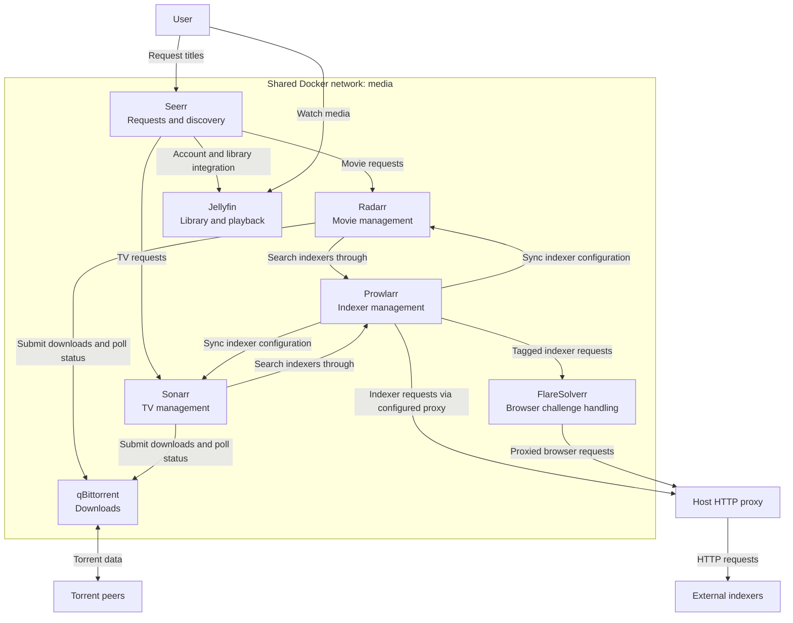
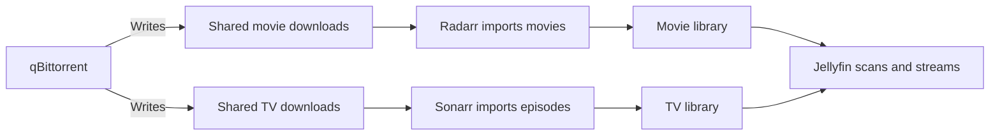

# Video service

A Docker Compose media stack for requesting, finding, downloading, organizing, and watching movies and TV shows. Each service has its own Compose file and Taskfile; the [root Taskfile](taskfile.yml) manages the whole stack.

## How the services communicate

All containers join the external Docker network `media` and reach each other by service name. The diagram shows the intended connections once the applications are configured. Compose creates the containers and network attachments; application integrations and API keys must be set up in their web interfaces.



See the [Prowlarr guide](prowlarr/README.md) for custom indexers and FlareSolverr integration, and the [FlareSolverr guide](flaresolverr/README.md) for shared HTTP proxy settings and v2rayA routing rules.

## From request to playback

1. A user requests a movie or TV show in Seerr. Once approved, Seerr sends it to Radarr or Sonarr.
2. Radarr or Sonarr searches the indexers configured through Prowlarr. Prowlarr can use FlareSolverr for tagged indexers that need browser challenge handling.
3. Radarr or Sonarr selects a release and submits it to qBittorrent, which downloads the files from torrent peers.
4. Radarr or Sonarr checks download status, then imports and organizes completed files into its library directory.
5. Jellyfin scans those library directories and makes the media available for playback. Seerr can sync library availability from Jellyfin.

Media files move through shared host directories, separately from the API calls above:



## Configuration sources

Each Compose file defines the service's image, environment, ports, volume mounts, and network membership. Use these files as the source of configuration values:

| Service | Configuration |
| --- | --- |
| Seerr | [Compose](seerr/compose.yml) |
| Radarr | [Compose](radarr/compose.yml) |
| Sonarr | [Compose](sonarr/compose.yml) |
| Prowlarr | [Compose](prowlarr/compose.yml) |
| qBittorrent | [Compose](qbittorrent/compose.yml) |
| Jellyfin | [Compose](jellyfin/compose.yml) |
| FlareSolverr | [Compose](flaresolverr/compose.yml) |

For a web interface, use the server hostname and the host side of its published port mapping. For container-to-container connections, use the Compose service name and the application's container port. FlareSolverr is accessible within the Docker network only.

## Start and configure

Install Docker with the Compose plugin and the `task` command (Go Task). Run from this directory:

```sh
task init
task up
```

Run `task init` before the first startup to [create the mounted folders and library subfolders and set their ownership](scripts/init-folders.sh), then prepare the shared network. The folder setup uses `sudo`. Use `task up` to start the services on subsequent runs. Ensure the proxy endpoint referenced in FlareSolverr's configuration is reachable.

You may want to link the show and movie libraries into your main media folder, such as `~/Videos`:

```sh
mkdir -p ~/Videos
ln -sv ~/Projects/repos/servers/media-service/sonarr/data/shows ~/Videos/
ln -sv ~/Projects/repos/servers/media-service/radarr/data/movies ~/Videos/
```

Adjust the repository path and destination folder for your setup. This creates `~/Videos/shows` and `~/Videos/movies` as symbolic links without copying the media files. The `-s` flag creates symbolic links, and `-v` prints each link as it is created.

After startup, configure these integrations in the applications' web interfaces using the folders prepared by `task init`:

1. **qBittorrent:** create separate movie and TV download categories and set each category's **Save path** to the corresponding container-side download mount in [its Compose file](qbittorrent/compose.yml).
2. **Radarr and Sonarr:** add qBittorrent as a download client using its internal address, credentials, and the corresponding category. Select the existing library directory as each application's root folder, using the container path whose host directory is also mounted into Jellyfin. If movie or series metadata requests are blocked, configure the [shared HTTP proxy](flaresolverr/README.md#shared-http-proxy) in each application too. Each application makes its own metadata requests, so configuring Prowlarr's proxy alone does not cover Radarr or Sonarr.
3. **Download path mapping:** the current mounts share host directories but expose different container paths, so each application needs a Remote Path Mapping. Use the configured download client host, the category's save path as the **Remote Path**, and the same host directory's container path in [Radarr](radarr/compose.yml) or [Sonarr](sonarr/compose.yml) as the **Local Path**. Skip this mapping if the mounts are changed to expose downloads at identical paths in qBittorrent and the importing application.
4. **Prowlarr:** add [indexers](prowlarr/README.md), configure the [shared HTTP proxy](flaresolverr/README.md#shared-http-proxy) and [FlareSolverr settings](prowlarr/README.md#flaresolverr-indexer-proxy), and add Radarr and Sonarr as applications using their internal addresses and API keys. Use Prowlarr's internal address as the Prowlarr server URL for those integrations.
5. **Jellyfin:** add Movies and TV libraries pointing to the existing shared library directories at their container paths, and configure library scans.
6. **Seerr:** connect Jellyfin, Radarr, and Sonarr using their internal addresses and required credentials/API keys. Select the library root folders and quality profiles for requests.

To open items with **Play on Jellyfin**, go to Seerr's **Settings → Media Server → Jellyfin** and set **External URL** to `http://localhost:8096`. Keep **Internal URL** as `http://jellyfin:8096`, click **Save**, then refresh the item's page. For browsers on another computer or phone, use the server's LAN address instead of `localhost`.

Bind mounts determine where application settings, downloads, libraries, and cache persist.

For the current mounts, add these entries under **Settings → Download Clients → Remote Path Mappings** in the corresponding application:

| Application | Host | Remote Path | Local Path |
| --- | --- | --- | --- |
| Radarr | `qbittorrent` | `/data/radarr/downloads/` | `/data/downloads/` |
| Sonarr | `qbittorrent` | `/data/sonarr/downloads/` | `/data/downloads/` |

The Host must match the host configured for that application's qBittorrent download client. These mappings translate the paths reported by qBittorrent to the same files inside Radarr or Sonarr. If the Docker download-directory warning appears, verify the mapping and run **System → Tasks → Check Health** after saving it.

## Common commands

| Command | Effect |
| --- | --- |
| `task init` | Prepare mounted folders, set ownership, and create the shared network if missing |
| `task up` | Start all services; run `task init` first to prepare folders and the network |
| `task down` | Stop and remove containers and Docker volumes with `docker compose down -v`; host bind-mounted directories remain |
| `task restart` | Run `down`, then `up` for the stack |
| `task update` | Pull the latest images; run `task up` afterward to recreate containers with the new images |
| `task sonarr:up` | Start one service; run `task init` first to prepare folders and the network |

Each service namespace also exposes `down`, `restart`, and `update`, for example `task jellyfin:update`.
